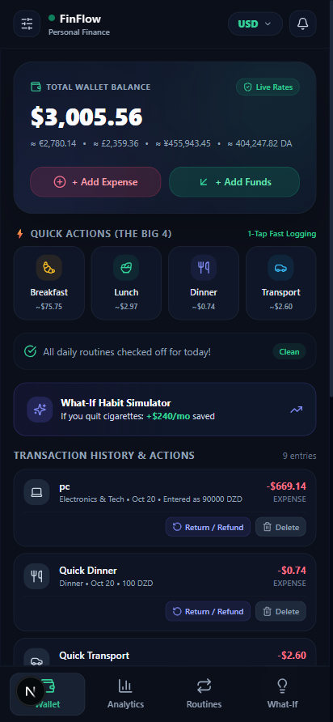
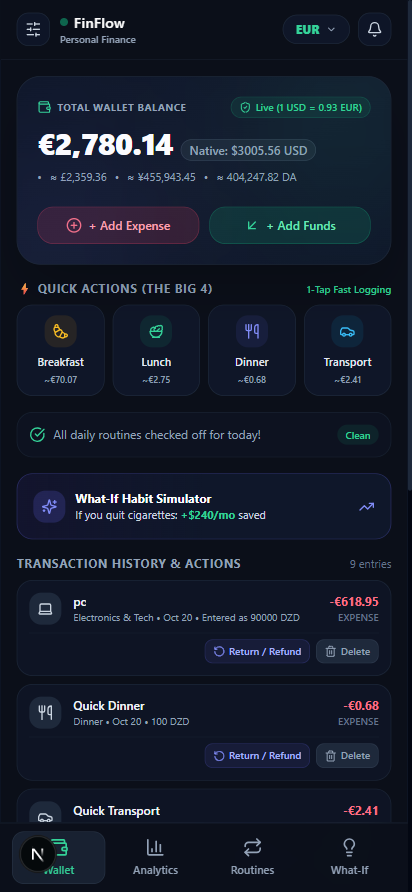
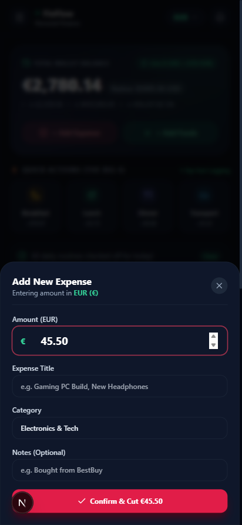
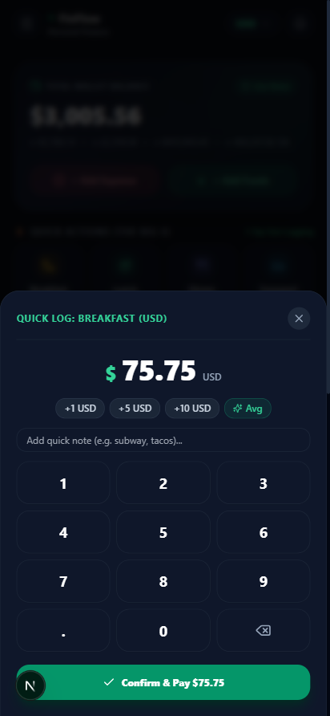
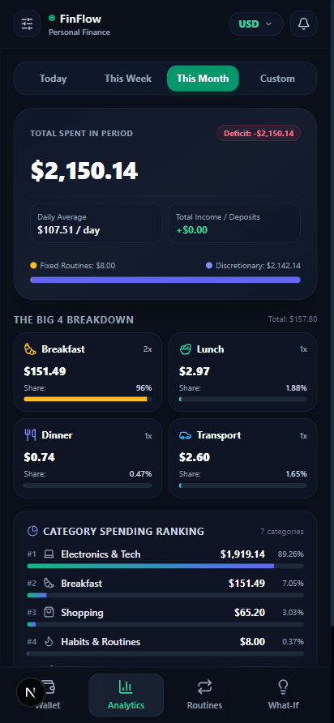
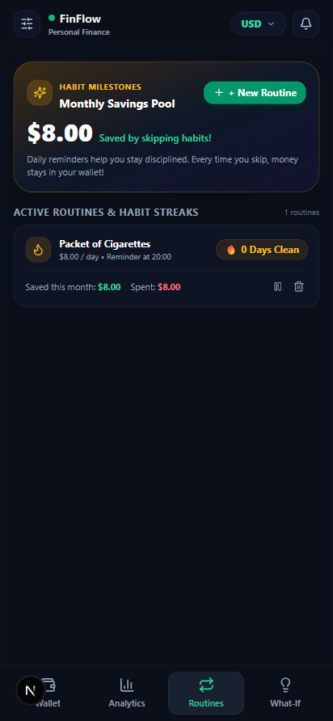
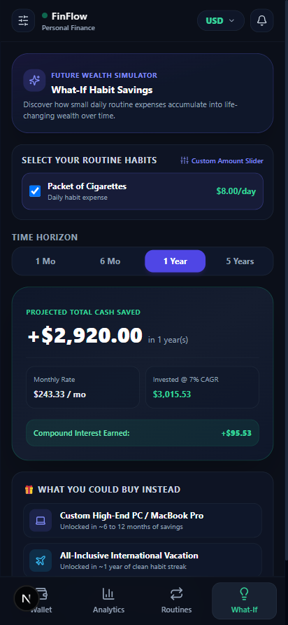
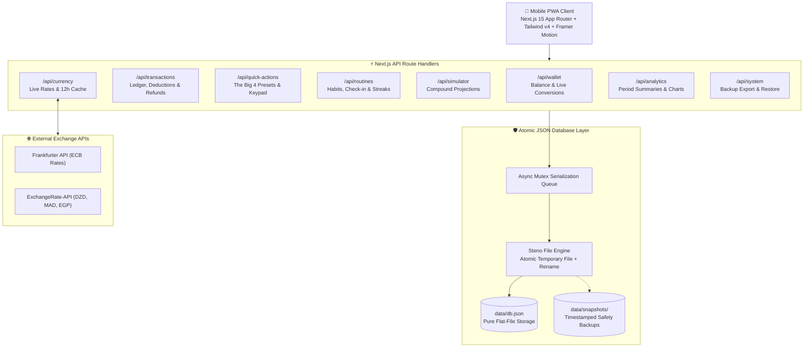

# 💳 FinFlow — Mobile-First Personal Finance Web Application

<p align="center">
  
</p>

<p align="center">
  <strong>A high-performance, mobile-first personal finance PWA with digital wallet aesthetics, daily routine expense tracking, compound savings simulation, live multi-currency conversion, and an atomic JSON-only database.</strong>
</p>

<p align="center">
  
  
  
  
  
  
</p>

---

## 📱 Mobile UI Showcase

FinFlow is designed from the ground up with native mobile-first touch ergonomics, smooth bottom-sheet modals, micro-interactions, and real-time live currency adaptation.

| **1. Digital Wallet & Big 4 Actions** | **2. Live Multi-Currency (EUR)** | **3. Dynamic Currency Entry** |
| :---: | :---: | :---: |
|  |  |  |
| *Hero card with real-time balance, multi-currency live conversions, and 1-tap Big 4 actions.* | *Instant switching to EUR, GBP, JPY, DZD, MAD with 12h ECB cached rates.* | *Automatic currency symbol adaptation (`€ 45.50`) and backend conversion to base.* |

<br/>

| **4. 1-Tap Quick Keypad Sheet** | **5. Period Analytics Dashboard** | **6. Daily Habit Routines** |
| :---: | :---: | :---: |
|  |  |  |
| *Custom mobile keypad with haptic-ready keys, rapid increments, and 1-tap logging.* | *Timeframe tabs (Today, Week, Month, Custom) with Big 4 spending distribution.* | *Check-in prompts, current & best streaks, and monthly habit projections.* |

<br/>

<p align="center">
  <strong>7. "What-If" Habit & Compound Savings Simulator</strong><br/>
  <br/>
  <em>Interactive compound interest projections (1M to 5Y @ 7%) with tangible real-world milestones (e.g. Sony headphones, MacBook).</em>
</p>

---

## ✨ Key Features

### 💳 1. Digital Wallet Card & Ledger
- **Sleek Hero Card UI**: Matte dark card with metallic borders, real-time balance display, dynamic multi-currency preview badges, and quick deposit/expense buttons.
- **Full Transaction Ledger**: Every entry is timestamped, categorized, and equipped with **1-click Refund/Undo** and **Delete** actions.
- **Dynamic Currency Adaptation**: When entering expenses or deposits, the currency symbol dynamically matches your active currency (`€`, `£`, `DA`, `DH`, `¥`, `$`), and backend handlers seamlessly convert the amount to base currency via live rates.

### ⚡ 2. The "Big 4" Quick Actions
- **1-Tap Fast Logging**: Dedicated one-touch actions for the 4 universal daily expenditures:
  - 🥐 **Breakfast**
  - 🍱 **Lunch**
  - 🍽️ **Dinner**
  - 🚇 **Transport**
- **Mobile Numeric Keypad Sheet**: Smooth bottom-sheet with large, thumb-friendly numeric keys, quick increment chips (`+5`, `+10`, `+20` auto-scaled to currency), and live average presets.

### 🚭 3. Daily Routine & Habit Tracker
- **Recurring Habit Management**: Track habits with fixed daily costs (e.g., cigarettes at $8.00/day, artisan coffee at $4.50/day).
- **Daily Yes/No Check-In Prompt**: A non-intrusive top banner prompts users each day: *"Did you spend on cigarettes today?"*
  - **Clicking "No"**: Increments streak counter, logs 0 expense, and triggers celebratory **confetti animation**.
  - **Clicking "Yes"**: Automatically deducts the cost from the wallet balance and records the transaction.
- **Streak & Milestone Stats**: Displays current clean streak, all-time best streak, and total money saved.

### 🔮 4. "What-If" Habit & Compound Savings Simulator
- **Future Wealth Projections**: Calculates projected savings over **1 Month**, **3 Months**, **6 Months**, **1 Year**, and **5 Years** with customizable annual compound interest (default: 7%).
- **Interactive Daily Spend Slider**: Adjust spending between $1 and $100/day with real-time reactive recalculations.
- **Tangible Purchasing Milestones**: Translates abstract savings into tangible real-world rewards (e.g., *1 Month = Sony Noise-Canceling Headphones ($240)*, *1 Year = High-End Gaming PC / Vacation ($2,920)*).

### 💱 5. Live Multi-Currency Engine
- **8 Supported Global & Regional Currencies**: `USD`, `EUR`, `GBP`, `JPY`, `CAD`, `DZD` (Algerian Dinar), `MAD` (Moroccan Dirham), and `EGP` (Egyptian Pound).
- **Resilient Dual-API Architecture**: Primary rates fetched from the European Central Bank (Frankfurter API) with graceful fallback to ExchangeRate-API for North African currencies.
- **12-Hour Local Cache**: Persisted in `data/db.json` to eliminate rate limits and provide instant, zero-latency currency conversions offline.

### 📊 6. Period Analytics & Category Breakdown
- **Flexible Timeframes**: Instant filtering across **Today**, **This Week**, **This Month**, or a **Custom Date Range**.
- **Big 4 Spending Breakdown**: Isolated metric cards showing total spent, transaction count, and percentage share for food & transport.
- **Interactive Visual Charts**: Touch-friendly Recharts visualizations for category distribution and daily spending velocity.

### 🛡️ 7. Atomic JSON-Only Database (Zero SQL, Zero MongoDB)
- **ACID-Compliant File Engine**: Built with **Lowdb** and **Steno** atomic file writes (`fs.promises.rename` via temporary files) combined with an in-memory Promise serialization queue.
- **Zero Configuration**: No database servers, Docker containers, or external connection strings required. All data lives in `data/db.json`.
- **Pre-Write Snapshots & Backup Recovery**: Automatic snapshot creation before dangerous operations, full one-click database export (`GET /api/system/export`), and JSON file restore (`POST /api/system/import`).

### 📱 8. Progressive Web App (PWA)
- **Installable Native Feel**: Add to iOS or Android home screen with `display: "standalone"`, splash icons, and responsive viewport locking.
- **Offline Reliability**: Service worker caches application assets and last-known data for viewing balances and history on the go.

---

## 🏗️ System Architecture



---

## 🛠️ Technology Stack

| Layer | Technology | Purpose |
| :--- | :--- | :--- |
| **Framework** | **Next.js 15.5** (App Router) | Server components, edge route handlers, zero-config build |
| **Runtime & UI** | **React 19** + **TypeScript** | Type-safe state management and modern hooks |
| **Styling** | **Tailwind CSS v4** | Mobile-first utility design, dark slate theme, touch-friendly UI |
| **Animations** | **Framer Motion** + **Canvas-Confetti** | 60 FPS bottom sheets, smooth tab transitions, celebration confetti |
| **Charts** | **Recharts** | Interactive SVG financial category donuts & velocity bar charts |
| **Icons** | **Lucide React** | Clean, lightweight SVG icon system |
| **Validation** | **Zod** | Runtime request payload validation across all endpoints |
| **Database** | **Lowdb 7.0** + **Steno** | ACID-safe atomic JSON flat-file storage (`data/db.json`) |
| **PWA** | Web App Manifest + Service Worker | Standalone mobile shell, offline resilience, home screen install |

---

## 🚀 Getting Started

### Prerequisites
- **Node.js**: `v18.17.0` or higher (`v20+` recommended)
- **Package Manager**: `npm`, `pnpm`, or `yarn`

### 1. Clone the Repository
```bash
git clone https://github.com/arezkisenouci/finance.git
cd finance
```

### 2. Install Dependencies
```bash
npm install
```

### 3. Run the Development Server
```bash
npm run dev
```
Open [http://localhost:3000](http://localhost:3000) in your mobile browser or desktop browser (with mobile devtools `Ctrl+Shift+M`).

### 4. Build for Production
```bash
npm run build
npm start
```

---

## 🔌 API Endpoints Summary

| Method | Endpoint | Description |
| :--- | :--- | :--- |
| `GET` | `/api/wallet` | Fetch current wallet balance and multi-currency converted rates |
| `POST` | `/api/wallet/deposit` | Add funds to wallet balance (supports any currency) |
| `PATCH` | `/api/wallet/base-currency` | Switch native base currency of the wallet |
| `GET` | `/api/transactions` | Paginated transaction ledger with category and date filtering |
| `POST` | `/api/transactions` | Create an expense/income transaction with live currency conversion |
| `POST` | `/api/transactions/[id]/refund` | 1-click refund: restores balance and marks transaction as refunded |
| `DELETE`| `/api/transactions/[id]` | Reverts balance mutation and deletes transaction record |
| `POST` | `/api/quick-actions/log` | 1-tap logging for Big 4 items (Breakfast, Lunch, Dinner, Transport) |
| `GET` | `/api/routines` | Retrieve active habits, monthly costs, and streak status |
| `POST` | `/api/routines/[id]/checkin` | Daily check-in: handles `did_spend: true/false` and streak increment |
| `GET` | `/api/simulator/routines` | Returns 1M, 6M, 1Y, 5Y compound savings projections for habits |
| `POST` | `/api/simulator/calculate` | Dynamic compound growth simulation with custom interest rates |
| `GET` | `/api/currency/rates` | Returns 12h-cached exchange rates for 8 supported currencies |
| `GET` | `/api/analytics/summary` | Period spending totals, discretionary vs. routine ratio, net savings |
| `GET` | `/api/analytics/quick-four` | Big 4 isolated spending, counts, and budget share |
| `GET` | `/api/system/export` | Download a raw JSON backup of `db.json` |
| `POST` | `/api/system/import` | Upload and restore `db.json` with pre-restore safety snapshot |

*For complete request schemas, parameters, and response structures, see [`backend_endpoints.md`](backend_endpoints.md).*

---

## 📚 Architectural Blueprints & Documentation

For comprehensive engineering specifications, refer to the documentation files in the repository:
- [**System Design & UI Wireframes (`system_design.md`)**](system_design.md) — Architectural patterns, JSON database structure, and UX workflows.
- [**Technology Stack & Constraints (`stack.md`)**](stack.md) — Technical constraints and atomic JSON storage mandate.
- [**Backend API Contracts (`backend_endpoints.md`)**](backend_endpoints.md) — Full REST specification for all 23 routes.
- [**Implementation Roadmap (`phases_plan.md`)**](phases_plan.md) — Phased milestone plan with Git push checkpoints.

---

## 📄 License

This project is licensed under the [MIT License](LICENSE).
