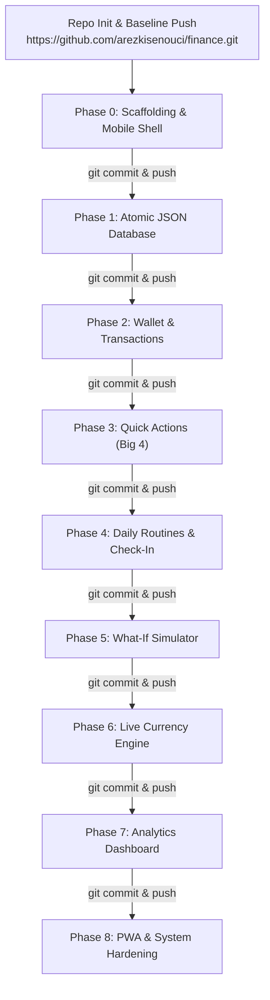

# Implementation Roadmap & Logical Phases Plan

> [!IMPORTANT]
> ### 🚨 CRITICAL DIRECTIVE FOR AI CODING AGENTS
> Before implementing or modifying code in **any phase**, the AI agent **MUST** inspect and adhere to the architectural blueprints in:
> 1. [**`system_design.md`**](file:///C:/Users/zix/Desktop/finance/system_design.md) — For data models, JSON database architecture, UI layout, and feature workflows.
> 2. [**`backend_endpoints.md`**](file:///C:/Users/zix/Desktop/finance/backend_endpoints.md) — For exact REST paths, request/response JSON contracts, and HTTP status codes.
> 3. [**`stack.md`**](file:///C:/Users/zix/Desktop/finance/stack.md) — For technology choices, library constraints, and the pure **JSON-only database** mandate (No SQL, No Mongo).
> 
> **Never invent schemas, change API signatures, or introduce unauthorized databases.** Complete each phase sequentially, verify all acceptance criteria, and check off the tasks before proceeding to the next.

---

## 🚀 GitHub Repository & Delivery Protocol

- **Target Repository**: `https://github.com/arezkisenouci/finance.git`
- **Default Branch**: `main`

### Repository Initialization Sequence
```bash
echo "# finance" >> README.md
git init
git add README.md
git commit -m "first commit"
git branch -M main
git remote add origin https://github.com/arezkisenouci/finance.git
git push -u origin main
```

### Mandatory Phase Gate Protocol
> [!CAUTION]
> **EVERY SINGLE PHASE MUST BE PUSHED TO GITHUB BEFORE ADVANCING TO THE NEXT PHASE.**
> After completing and verifying a phase:
> 1. Stage all changes: `git add .`
> 2. Commit with conventional commit prefix: `git commit -m "feat(phase-X): <summary of deliverables>"`
> 3. Push to GitHub: `git push origin main`
> 4. Verify remote push succeeds before starting the subsequent phase.

---

## Roadmap Overview



---

## Initial Setup: Git Repository Baseline

- [ ] Verify `README.md` exists with project summary.
- [ ] Initialize git repository (`git init`), configure branch `main`.
- [ ] Connect remote `origin`: `git remote add origin https://github.com/arezkisenouci/finance.git`.
- [ ] Initial commit of documentation files (`system_design.md`, `stack.md`, `backend_endpoints.md`, `phases_plan.md`, `README.md`).
- [ ] Initial push: `git push -u origin main`.

---

## Phase 0: Project Scaffolding & Mobile Shell

**Objective**: Initialize the repository with the approved modern stack, establish mobile-first UI layout constraints, and setup UI component libraries.

### Tasks
- [x] Initialize Next.js 15 (App Router) project with TypeScript and ESLint.
- [x] Configure Tailwind CSS and install `lucide-react`, `clsx`, `tailwind-merge`, and `canvas-confetti`.
- [x] Install and configure headless primitives via `shadcn/ui` (Dialog, Drawer/BottomSheet, DropdownMenu, Tabs, Tooltip).
- [x] Setup Framer Motion for mobile animations.
- [x] Create the **Mobile Shell Layout** (`app/layout.tsx`):
  - Lock container to `max-w-md mx-auto min-h-screen bg-slate-950 text-slate-50 flex flex-col`.
  - Implement the sticky top header (Settings icon, App Title, Currency Badge, Notification Bell).
  - Implement the persistent bottom navigation bar (Wallet, Analytics, Routines, What-If).
- [x] Setup PWA baseline (`manifest.json` and meta viewport tags for iOS/Android).

### Verification & Git Gate
- [x] Run `npm run dev` / `pnpm dev` / `npm run build`.
- [x] Verify the mobile viewport looks like a native phone screen centered on desktop and full-width on mobile devtools.
- [x] All 4 bottom navigation tabs toggle active states without layout jitter.
- [x] **Push Phase to GitHub**:
  ```bash
  git add .
  git commit -m "feat(phase-0): scaffold Next.js 15 app with mobile shell and PWA baseline"
  git push origin main
  ```

---

## Phase 1: Atomic JSON Database Layer & Data Integrity

**Objective**: Build the pure JSON-only database engine using **Lowdb** and **Steno** with atomic file writing, automatic schema validation, and snapshot backups.

### Reference
- `system_design.md` Section 5 (Schema Specification) & Section 6 (Concurrency & Atomic Writes).

### Tasks
- [x] Install `lowdb` (v7+) and `zod`.
- [x] Define TypeScript interfaces and Zod validation schemas for all entities in `types/database.ts`:
  - `WalletSchema`
  - `CategorySchema`
  - `RoutineSchema`
  - `RoutineLogSchema`
  - `TransactionSchema`
  - `ExchangeRatesCacheSchema`
  - `DatabaseSchema`
- [x] Create the database client in `lib/db.ts`:
  - Initialize `data/db.json` with fallback defaults if the file does not exist.
  - Implement read/write helper methods with concurrency locking.
  - Implement atomic write safety via Steno.
- [x] Create database seed script (`scripts/seed.ts` or auto-init on boot):
  - Initial balance: `$3,840.50` (USD).
  - Seed the 4 quick categories: Breakfast, Lunch, Dinner, Transport.
  - Seed sample categories: Habits & Routines, Tech & Electronics, Miscellaneous.
  - Seed initial routine: "Packet of Cigarettes" ($8.00/day).
- [x] Implement automated backup utility in `lib/backup.ts` to archive rolling daily snapshots into `data/backups/db-YYYY-MM-DD.json`.

### Verification & Git Gate
- [x] Run standalone test script that writes, reads, and updates `data/db.json`.
- [x] Intentionally verify atomic file rename ensures zero JSON corruption.
- [x] Confirm schema validation rejects malformed payloads (e.g., negative amounts).
- [x] **Push Phase to GitHub**:
  ```bash
  git add .
  git commit -m "feat(phase-1): implement atomic Lowdb JSON database layer with Zod validation"
  git push origin main
  ```

---

## Phase 2: Wallet Hero & Transaction Ledger (Core Engine)

**Objective**: Implement the digital wallet card, balance mutations (cutting balance upon expense), transaction ledger, mistake undo (delete), and item return/refund functionality.

### Reference
- `backend_endpoints.md` Section 2 (Wallet) & Section 3 (Transactions).
- `system_design.md` Section 3 (Wireframe) & Section 4.1 (Wallet Logic).

### Tasks
- [x] **Backend Route Handlers**:
  - `GET /api/wallet` — returns current balance, base currency, and last update.
  - `POST /api/wallet/deposit` — adds money, logs income transaction, updates balance.
  - `GET /api/transactions` — fetches list with filtering by period, type, and pagination.
  - `POST /api/transactions` — records expense, deducts amount from wallet, saves to JSON.
  - `DELETE /api/transactions/:id` — deletes transaction, restores money back to wallet.
  - `POST /api/transactions/:id/refund` — flags transaction as `isRefunded: true`, adds refund record, restores balance.
- [x] **Frontend UI Components**:
  - `WalletCard`: Apple Wallet-style dark card displaying formatted balance with count-up animation (`Framer Motion`).
  - `AddExpenseDrawer`: Bottom-sheet modal with fields for Title (e.g. "Gaming PC"), Amount ($1250), Category selector, and "Deduct from Wallet" button.
  - `AddFundsModal`: Quick dialog to add income / salary deposits.
  - `TransactionLedger`: Clean list of transactions displaying icons, amount colors (red for expense, green for income), and formatted dates.
  - `TransactionItemActions`: Slide-to-reveal or dropdown menu on each item with **[Refund / Return]** and **[Delete / Mistake Undo]** buttons.

### Verification & Git Gate
- [x] Log an expense of `$1,200` ("Gaming PC") $\to$ wallet balance decreases from `$3,840.50` to `$2,640.50`.
- [x] Tap **Delete** on the PC entry $\to$ balance restores back to `$3,840.50`.
- [x] Log the expense again and tap **Refund** $\to$ balance restores back to `$3,840.50`, entry shows badge `[Refunded]`, and a refund transaction appears in history.
- [x] **Push Phase to GitHub**:
  ```bash
  git add .
  git commit -m "feat(phase-2): build digital wallet card, balance mutations, and transaction ledger"
  git push origin main
  ```

---

## Phase 3: The "Big 4" Quick Actions (Breakfast, Lunch, Dinner, Transport)

**Objective**: Provide 1-tap rapid entry on the main screen for the four most frequent daily expenses so users can log them in under 2 seconds without friction.

### Reference
- `backend_endpoints.md` Section 4 (Quick Actions).
- `system_design.md` Section 4.4 (Quick Actions Row).

### Tasks
- [x] **Backend Route Handlers**:
  - `GET /api/quick-actions` — returns the 4 categories (Breakfast, Lunch, Dinner, Transport) with default and historical average amounts.
  - `POST /api/quick-actions/log` — ultra-lightweight endpoint that takes `{ categoryId, amount, notes }`, logs the transaction, and deducts the balance.
- [x] **Frontend UI Components**:
  - `QuickActionsBar`: Horizontal row of 4 tactile buttons on the home screen:
    - 🥐 **Breakfast**
    - 🥗 **Lunch**
    - 🍝 **Dinner**
    - 🚕 **Transport**
  - `QuickEntryKeypad`: Fast mobile bottom-sheet numeric keypad triggered when tapping any of the 4 buttons, pre-filled with the recent average amount.
  - Visual feedback: Micro-haptic vibration (via `navigator.vibrate` if supported) and instant wallet balance decrement animation.

### Verification & Git Gate
- [x] Tap `[🥗 Lunch]` $\to$ bottom keypad opens in $< 100\text{ms}$.
- [x] Enter `$14.50` and hit `Confirm` $\to$ transaction is saved with `isQuickAction: true`, and the wallet balance updates immediately.
- [x] **Push Phase to GitHub**:
  ```bash
  git add .
  git commit -m "feat(phase-3): implement Big 4 quick actions with 1-tap mobile keypad"
  git push origin main
  ```

---

## Phase 4: Daily Routine Tracker & Daily Reminder Check-In

**Objective**: Automate daily routine expenses (e.g., packet of cigarettes every day) with an interactive daily prompt ("Did you spend on this today? [Yes] [No]"), streak counter, and celebratory feedback for skipped days.

### Reference
- `backend_endpoints.md` Section 5 (Daily Routines).
- `system_design.md` Section 4.2 (Daily Routine & Check-In System).

### Tasks
- [x] **Backend Route Handlers**:
  - `GET /api/routines` — retrieves all routines with streak stats and monthly spend/saved aggregates.
  - `POST /api/routines` — creates a new routine (title, cost, frequency, reminderTime).
  - `PATCH /api/routines/:id` & `DELETE /api/routines/:id` — edits or disables a routine.
  - `GET /api/routines/pending-today` — checks whether today's date has an entry in `routine_logs`.
  - `POST /api/routines/:id/checkin` — records user action:
    - If `CONFIRMED` (Yes): creates an expense transaction, deducts cost from wallet, updates log.
    - If `SKIPPED` (No): leaves wallet balance untouched, increments skipped streak, marks money as saved.
- [x] **Frontend UI Components**:
  - `DailyReminderBanner`: High-priority card on the main dashboard if a routine is pending for today:
    > *"Did you buy a packet of cigarettes today ($8.00)?"*
    > `[ ❌ No, Skipped! ]`   `[ ✅ Yes, Bought ]`
  - `RoutineManagerView`: Settings/management page to add, edit, or delete routines.
  - `CelebrationEffect`: Trigger confetti burst (`canvas-confetti`) when user clicks `[No, Skipped!]` along with a toast: *"Saved $8.00 today! Streak: X days!"*.

### Verification & Git Gate
- [x] Set up a routine: "Packet of Cigarettes" at `$8.00/day`.
- [x] When clicking `[Yes, Bought]`: an `$8.00` expense is added to the ledger, wallet balance reduces by `$8.00`, and reminder banner disappears for the day.
- [x] Reset/test with `[No, Skipped!]`: wallet balance does not decrease, streak increments by 1, and confetti triggers.
- [x] **Push Phase to GitHub**:
  ```bash
  git add .
  git commit -m "feat(phase-4): add daily routine tracking, check-in banner, and streak celebration"
  git push origin main
  ```

---

## Phase 5: "What-If" Habit & Savings Simulator

**Objective**: Give users an interactive playground to calculate how much money they would save over 1 month, 6 months, 1 year, and 5 years if they eliminated or reduced daily routine expenses (e.g. quitting cigarettes).

### Reference
- `backend_endpoints.md` Section 6 (Simulator).
- `system_design.md` Section 4.3 (What-If Habit Simulator).

### Tasks
- [x] **Backend Route Handlers**:
  - `GET /api/simulator/routines` — calculates projections (1M, 3M, 6M, 1Y, 5Y with 7% compound interest) for all configured routines.
  - `POST /api/simulator/calculate` — dynamic endpoint accepting arbitrary `{ dailyExpenseAmount, durationMonths, annualInterestRate }`.
- [x] **Frontend UI Components**:
  - `WhatIfSimulatorCard`: Engaging dashboard card showing immediate monthly and yearly savings.
  - `SimulatorModal / Page`:
    - Sliders to adjust daily spend (e.g., $1 to $50/day).
    - Multi-routine toggle checkboxes (e.g., [x] Cigarettes $8, [x] Coffee $5).
    - Interactive visual comparison bar chart (Actual Spending vs. Potential Savings).
    - Real-world purchasing power milestones (e.g., *"In 1 month you save $240 = Sony Headphones; in 1 year you save $2,920 = High-end PC"*).

### Verification & Git Gate
- [x] Select "Cigarettes ($8/day)" $\to$ verifies that 30-day projection equals `$240.00`, 365-day projection equals `$2,920.00`, and 5-year compound growth is calculated accurately.
- [x] Sliders respond smoothly at 60 FPS without UI stutter.
- [x] **Push Phase to GitHub**:
  ```bash
  git add .
  git commit -m "feat(phase-5): build What-If habit savings simulator and compound growth projections"
  git push origin main
  ```

---

## Phase 6: Live Currency Converter & Multi-Currency Engine

**Objective**: Enable live foreign currency exchange rates so users can view their wallet balance, budget, and expenses converted into any global currency with local 12-hour caching.

### Reference
- `backend_endpoints.md` Section 8 (Currency & Exchange Rates).
- `system_design.md` Section 4.6 (Multi-Currency Architecture) & `stack.md` Section 3.5.

### Tasks
- [x] **Backend Route Handlers & Integration**:
  - `lib/forex.ts`: Service integrating **Frankfurter API** (primary free ECB rates) and **ExchangeRate-API** (fallback for 160+ currencies like DZD, MAD, EGP).
  - Caching logic: Persist rates in `exchange_rates_cache` inside `data/db.json` with a 12-hour timestamp TTL.
  - `GET /api/currency/rates` — serves cached rates (or refreshes from external API if older than 12h).
  - `POST /api/currency/convert` — converts arbitrary amounts between two currencies.
  - `PATCH /api/wallet/base-currency` — switches the wallet's native base currency.
- [x] **Frontend UI Components**:
  - `CurrencySelector`: Compact dropdown pill in the top header (`[USD ▼]`, `[EUR ▼]`, `[GBP ▼]`, `[JPY ▼]`, `[DZD ▼]`, etc.).
  - Secondary currency badge on the wallet card (e.g., `$3,840.50 USD ≈ €3,552.46 EUR`).
  - Toggle to preview transactions in the selected currency.

### Verification & Git Gate
- [x] Query rates while offline or simulate API failure $\to$ system seamlessly serves cached rates from `db.json`.
- [x] Switch currency to `EUR` $\to$ wallet hero and transactions accurately display converted amounts using the cached rate.
- [x] **Push Phase to GitHub**:
  ```bash
  git add .
  git commit -m "feat(phase-6): implement live forex rates with 12h cache and currency switcher"
  git push origin main
  ```

---

## Phase 7: Analytics Dashboard & Advanced Date Filtering

**Objective**: Build a detailed reporting dashboard to analyze where money goes across Today, This Week, This Month, or Custom Date Ranges, featuring dedicated breakdowns for the Big 4 categories (Breakfast, Lunch, Dinner, Transport).

### Reference
- `backend_endpoints.md` Section 7 (Analytics & Reports).
- `system_design.md` Section 4.5 (Filter & Period Analytics Engine).

### Tasks
- [ ] **Backend Route Handlers**:
  - `GET /api/analytics/summary` — computes total income, total spent, net savings, and routine vs discretionary split for a given period.
  - `GET /api/analytics/quick-four` — isolates spending and percentages for the 4 quick categories (Breakfast, Lunch, Dinner, Transport).
  - `GET /api/analytics/categories` — returns full category rankings and percentage distributions.
- [ ] **Frontend UI Components**:
  - `PeriodTabs`: Mobile segmented control: `[ Today ] [ This Week ] [ This Month ] [ Custom Range ]`.
  - `CustomDateRangePicker`: Mobile-friendly date picker bottom sheet.
  - `QuickFourBreakdownGrid`: 4 interactive stat cards displaying spend, count, and percentage of food/transport budget.
  - `CategoryDonutChart`: Touch-sensitive Recharts Donut chart with smooth slice expand animations.
  - `SpendingVelocityBarChart`: Daily spending bars showing high-spend spikes vs low-spend days.

### Verification & Git Gate
- [ ] Select `This Month` $\to$ verify that the sum of all expenses in the month matches the total reported.
- [ ] Verify the Quick 4 Breakdown reflects all transactions categorized under Breakfast, Lunch, Dinner, and Transport.
- [ ] Test `Custom Range` with arbitrary dates $\to$ data updates accurately.
- [ ] **Push Phase to GitHub**:
  ```bash
  git add .
  git commit -m "feat(phase-7): build period analytics dashboard with Big 4 category breakdowns"
  git push origin main
  ```

---

## Phase 8: PWA Installation, Offline Capability & System Hardening

**Objective**: Finalize Progressive Web App capabilities (installable to home screen), offline viewing, raw database backup export/import, and end-to-end polish.

### Reference
- `backend_endpoints.md` Section 9 (System & Backup).
- `stack.md` Section 3.2 (PWA) & Section 4.

### Tasks
- [ ] **PWA Configuration**:
  - Setup service worker with offline caching strategy for app shell and recent data.
  - Add Apple touch icons and splash screens in `public/icons/`.
  - Configure `manifest.json` for `display: "standalone"` and orientation lock.
- [ ] **Database Backup & Restore UI**:
  - `GET /api/system/export` — trigger raw `db.json` download.
  - `POST /api/system/import` — file upload to restore database with pre-restore safety snapshot.
  - `SettingsDrawer`: UI controls to export backup or restore from file.
- [ ] **Edge Case Hardening**:
  - Validate non-numeric or negative input values in forms using Zod.
  - Handle zero-transaction empty states with helpful illustrations.
  - Perform memory and bundle audit to ensure fast $< 1\text{s}$ load on mobile 4G.

### Verification & Git Gate
- [ ] Install app to phone or Chrome desktop via "Install App" prompt.
- [ ] Disconnect internet $\to$ app opens, shows cached balance, and allows viewing recent history without crashing.
- [ ] Export `db.json`, modify it, and import it $\to$ app successfully validates and loads the imported state.
- [ ] **Push Phase to GitHub**:
  ```bash
  git add .
  git commit -m "feat(phase-8): finalize PWA offline capabilities, backup export/import, and polish"
  git push origin main
  ```

---

## Summary Checklist

| Phase | Milestone | Git Commit & Push Status |
| :--- | :--- | :--- |
| **Initial Setup** | Documentation & Architecture Baseline | `COMPLETED` |
| **Phase 0** | Project Scaffolding & Mobile Shell | `COMPLETED` |
| **Phase 1** | Atomic Lowdb JSON Database Layer | `COMPLETED` |
| **Phase 2** | Digital Wallet Hero & Transaction Ledger | `COMPLETED` |
| **Phase 3** | The "Big 4" Quick Actions | `COMPLETED` |
| **Phase 4** | Daily Routine Tracker & Daily Check-In | `COMPLETED` |
| **Phase 5** | What-If Habit & Savings Simulator | `COMPLETED` |
| **Phase 6** | Live Multi-Currency Engine | `COMPLETED` |
| **Phase 7** | Period Analytics Dashboard | `PENDING` |
| **Phase 8** | PWA Offline & System Hardening | `PENDING` |
