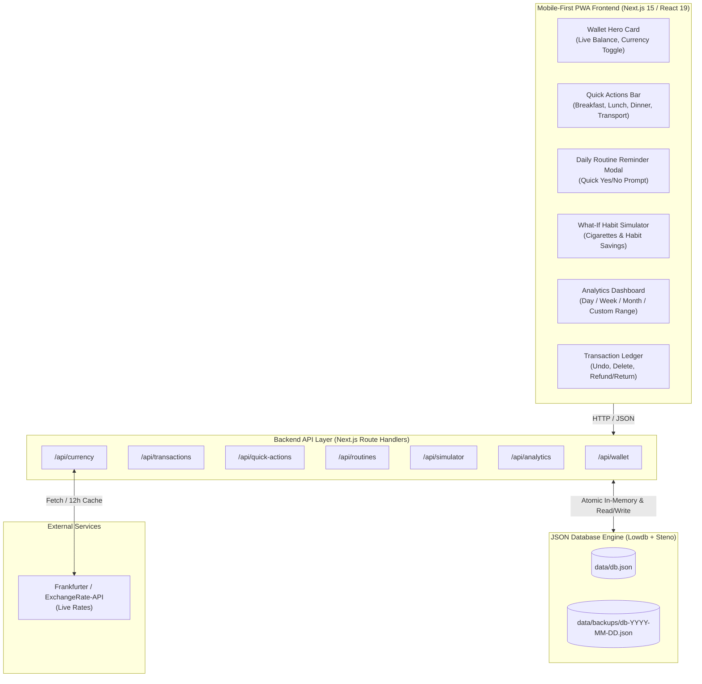
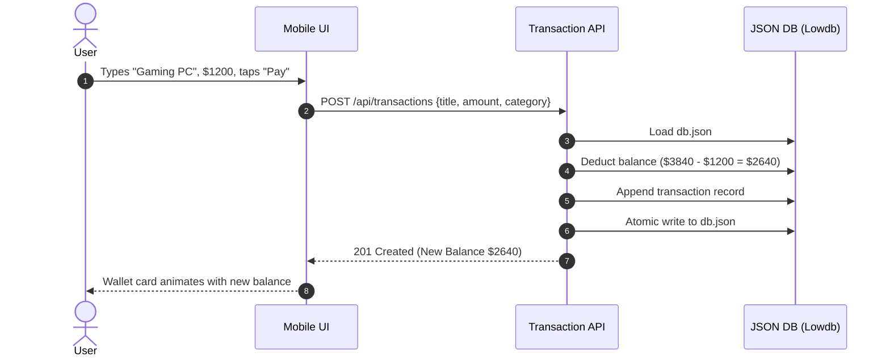
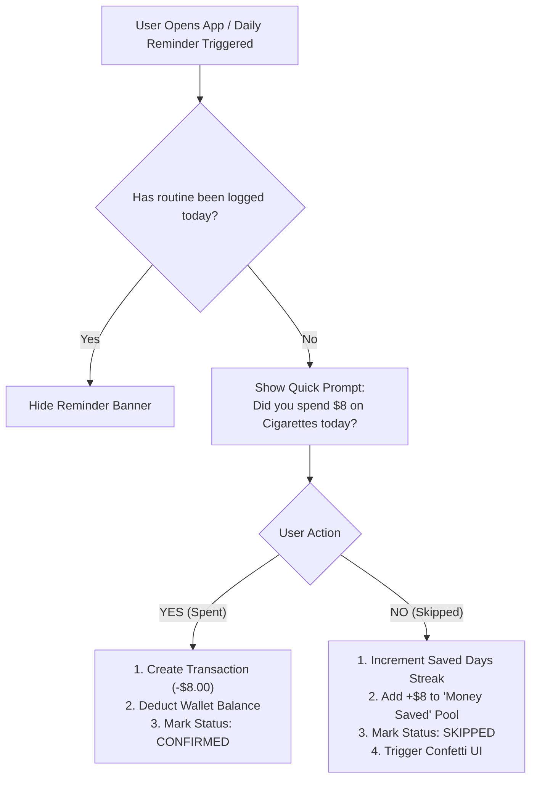

# System Design: Mobile-First Personal Finance Platform

## 1. System Overview & Vision

The **Personal Finance Platform** is an intuitive, mobile-first Web Application (PWA) engineered to operate like a luxury digital wallet (inspired by Apple Wallet, Revolut, and Cash App). It provides real-time financial tracking, routine habit management, "What-If" savings simulations, quick-action logging for core daily expenditures, and instant foreign currency conversions—all underpinned by an atomic, zero-overhead **JSON flat-file database**.

---

## 2. Architecture Diagram



---

## 3. Mobile UI/UX Design & Layout Blueprint

The application viewport is constrained to a mobile shell (`max-w-md mx-auto min-h-screen`) on desktop monitors and spans 100% full-screen on mobile devices.

### 3.1 Screen Hierarchy & Layout Mockup

```
+-----------------------------------------------------------+
|  [⚙ Settings]      FinFlow Wallet       [USD ▼] [🔔 (1)]  |
+-----------------------------------------------------------+
|                                                           |
|  +-----------------------------------------------------+  |
|  |  TOTAL BALANCE                                      |  |
|  |  $ 3,840.50                                         |  |
|  |  ≈ € 3,556.26 EUR  |  ≈ ¥ 582,600 JPY               |  |
|  |                                                     |  |
|  |  [ + Add Expense ]         [ + Add Income / Funds ] |  |
|  +-----------------------------------------------------+  |
|                                                           |
|  ⚡ QUICK ACTIONS (Tap to log amount)                     |
|  +-----------+  +-----------+  +-----------+  +---------+  |
|  | 🥐 B-Fast |  | 🥗 Lunch  |  | 🍝 Dinner |  | 🚕 Ride |  |
|  +-----------+  +-----------+  +-----------+  +---------+  |
|                                                           |
|  🔔 DAILY ROUTINE CHECK-IN (1 Pending Today)              |
|  +-----------------------------------------------------+  |
|  | "Did you buy a pack of cigarettes today ($8.00)?"    |  |
|  |                                                     |  |
|  |      [ ❌ No, I Skipped! ]       [ ✅ Yes, Bought ]   |  |
|  +-----------------------------------------------------+  |
|                                                           |
|  💡 WHAT-IF SAVINGS SIMULATOR                             |
|  +-----------------------------------------------------+  |
|  | If you quit "Cigarettes ($8/day)":                  |  |
|  | • This Month: +$240 Saved                           |  |
|  | • This Year:  +$2,920 Saved (Could buy 2 PCs!)      |  |
|  | [ Explore Simulation Sliders > ]                    |  |
|  +-----------------------------------------------------+  |
|                                                           |
|  📊 SPENDING BREAKDOWN                                    |
|  [ Today ]  [ This Week ]  [ [This Month] ]  [ Custom ]   |
|  +-----------------------------------------------------+  |
|  | ( Donut Chart: Food 42% | Transport 18% | PC 35% )  |  |
|  | • 🥐 Breakfast:  $ 120.00                           |  |
|  | • 🥗 Lunch:      $ 210.00                           |  |
|  | • 🍝 Dinner:     $ 275.00                           |  |
|  | • 🚕 Transport:  $  95.00                           |  |
|  +-----------------------------------------------------+  |
|                                                           |
|  🕒 RECENT TRANSACTIONS                                   |
|  • Gaming PC Purchase       -$1,250.00  [Return/Refund]   |
|  • Metro Ticket                -$ 3.50  [Delete]          |
|                                                           |
|===========================================================|
|  [ 🏠 Wallet ]   [ 📊 Stats ]   [ 🔄 Routines ]   [ ⚙ ]  |
+-----------------------------------------------------------+
```

---

## 4. Core Feature Workflows & Logic

### 4.1 Wallet & Transaction Engine
1. **Initial & Ongoing Balance**:
   - The user configures an initial balance (or logs salary/income deposits).
   - Any manual expense (e.g., buying a new PC for `$1,200`) instantly reduces `wallet.balance`.
2. **Refund / Item Return Mechanism**:
   - If an item is returned or refunded (e.g. returning the PC or an accidental double charge):
     - The transaction is marked as `isRefunded: true`.
     - The refund amount is credited directly back to `wallet.balance`.
     - A companion `REFUND` record is logged in the ledger referencing the original `transactionId`.
3. **Mistake Deletion (Undo)**:
   - Soft-delete or hard-delete capability.
   - Deleting an expense recalculates the balance by adding back the deducted sum.



---

### 4.2 Daily Routine & Check-In System

The routine engine handles daily habits (e.g., smoking cigarettes, buying a daily latte, gym subscription).

1. **Routine Setup**:
   - User creates a routine with:
     - `title`: "Packet of Cigarettes"
     - `cost`: `$8.00`
     - `frequency`: `DAILY`
     - `category`: `Habits`
     - `reminderTime`: `20:00` (8:00 PM)
2. **Automated Check-in Prompt**:
   - Every day, the system evaluates if today's date has a logged status in `routine_logs`.
   - If unconfirmed, an urgent banner or push notification displays:
     > *"Did you buy a packet of cigarettes today for $8.00? [Yes] [No]"*
3. **Decision Branches**:
   - **Click [Yes]**:
     - System logs a transaction for `$8.00` with category `Habits`.
     - Deducts `$8.00` from wallet balance.
     - Sets routine log status to `CONFIRMED`.
   - **Click [No]**:
     - No balance is deducted.
     - Sets routine log status to `SKIPPED`.
     - Increments the user's **Streak of Clean Days**.
     - Updates the **Money Saved Counter** with celebratory confetti.



---

### 4.3 "What-If" Habit & Savings Simulator

The simulator provides psychological reinforcement and financial foresight:

1. **Simulation Formula**:
   $$\text{Daily Cost} = \sum_{\text{selected habits}} \text{cost per day}$$
   $$\text{Savings}_{\text{Month}} = \text{Daily Cost} \times \text{Days in Month (e.g. 30)}$$
   $$\text{Savings}_{\text{Year}} = \text{Daily Cost} \times 365$$
   $$\text{Opportunity Cost (5 Years @ 7% Annual Investment)} = \text{PMT}(\text{Monthly Savings}, 7\%, 5 \text{ years})$$

2. **Interactive UI**:
   - Sliders allowing the user to select habits (e.g., 🚬 Cigarettes: $8/day, ☕ Artisanal Coffee: $5/day).
   - Real-time comparison:
     - *"By skipping cigarettes this month, you save **$240**."*
     - *"By skipping cigarettes this year, you save **$2,920** (Enough to buy an M3 MacBook Pro + iPad)."*
     - *"Over 5 years with compound interest: **$17,350**."*

---

### 4.4 Quick Actions Row (The Big 4 Categories)

To minimize friction and prevent logging fatigue:
- The top of the dashboard features 4 dedicated quick-tap buttons:
  - 🥐 **Breakfast**
  - 🥗 **Lunch**
  - 🍝 **Dinner**
  - 🚕 **Transport**
- **1-Tap Workflow**:
  1. User taps `[🥗 Lunch]`.
  2. A native bottom-sheet numeric keypad glides up with preset recent amounts (e.g., `$12`, `$15`, `$20`, or custom).
  3. User enters amount and taps `Confirm`.
  4. Instant transaction creation and balance deduction in $< 2$ seconds.

---

### 4.5 Filter & Period Analytics Engine

The user can view breakdowns by switching tabs:
- **Today** (Midnight to 23:59:59)
- **This Week** (Monday to Sunday)
- **This Month** (1st to current date or end of month)
- **Custom Date Range** (Start Date $\to$ End Date)

**Analytics Output**:
1. **Total Spent in Period** vs **Total Income**.
2. **Net Flow** ($Income - Expenses$).
3. **Category Breakdown**:
   - Dedicated metrics for the 4 core categories: Breakfast, Lunch, Dinner, Transport.
   - Other categories grouped and ranked in descending order.
4. **Routine vs Discretionary Ratio**:
   - Visual comparison: How much was spent on fixed daily routines vs impulse/one-off purchases.

---

### 4.6 Multi-Currency Conversion Architecture

1. **Base Currency Principle**:
   - The primary wallet data is stored in the user's selected `baseCurrency` (e.g. `USD`).
2. **Display Currency Switcher**:
   - The user can tap the currency selector at any time (e.g., switch to `EUR`, `GBP`, `JPY`, `CAD`).
   - The frontend instantly calculates:
     $$\text{Display Amount} = \text{Stored Amount} \times \text{ExchangeRate}(\text{Base} \to \text{Target})$$
3. **Caching Strategy**:
   - The backend checks `exchange_rates_cache.json`.
   - If rates are fresh ($< 12\text{ hours}$ old), cached rates are served instantly (sub-millisecond latency).
   - If stale, the backend queries the Frankfurter/ExchangeRate API, updates the JSON cache, and returns new rates.

---

## 5. JSON Database Schema Specification

The entire application state is persisted in `data/db.json` with strict TypeScript and Zod schemas.

```json
{
  "wallet": {
    "balance": 3840.50,
    "baseCurrency": "USD",
    "updatedAt": "2026-10-20T20:10:00.000Z"
  },
  "categories": [
    { "id": "cat_breakfast", "name": "Breakfast", "icon": "Croissant", "isQuickAction": true },
    { "id": "cat_lunch", "name": "Lunch", "icon": "Salad", "isQuickAction": true },
    { "id": "cat_dinner", "name": "Dinner", "icon": "Utensils", "isQuickAction": true },
    { "id": "cat_transport", "name": "Transport", "icon": "Car", "isQuickAction": true },
    { "id": "cat_habits", "name": "Habits & Routines", "icon": "Flame", "isQuickAction": false },
    { "id": "cat_tech", "name": "Electronics & Tech", "icon": "Laptop", "isQuickAction": false },
    { "id": "cat_misc", "name": "Miscellaneous", "icon": "Receipt", "isQuickAction": false }
  ],
  "routines": [
    {
      "id": "rt_cigg_001",
      "title": "Packet of Cigarettes",
      "cost": 8.00,
      "currency": "USD",
      "categoryId": "cat_habits",
      "frequency": "DAILY",
      "reminderTime": "20:00",
      "isActive": true,
      "createdAt": "2026-10-01T08:00:00.000Z"
    }
  ],
  "routine_logs": [
    {
      "id": "rtl_20261020_001",
      "routineId": "rt_cigg_001",
      "date": "2026-10-20",
      "status": "CONFIRMED", // "CONFIRMED" | "SKIPPED" | "PENDING"
      "transactionId": "tx_99812",
      "savedAmount": 0.00,
      "loggedAt": "2026-10-20T19:45:10.000Z"
    }
  ],
  "transactions": [
    {
      "id": "tx_99810",
      "title": "Gaming PC Build",
      "amount": 1250.00,
      "type": "EXPENSE",
      "categoryId": "cat_tech",
      "isQuickAction": false,
      "isRoutine": false,
      "isRefunded": false,
      "date": "2026-10-18T14:22:00.000Z",
      "notes": "Custom desktop workstation"
    },
    {
      "id": "tx_99811",
      "title": "Subway Ride",
      "amount": 2.75,
      "type": "EXPENSE",
      "categoryId": "cat_transport",
      "isQuickAction": true,
      "isRoutine": false,
      "isRefunded": false,
      "date": "2026-10-20T08:30:00.000Z"
    },
    {
      "id": "tx_99812",
      "title": "Packet of Cigarettes",
      "amount": 8.00,
      "type": "EXPENSE",
      "categoryId": "cat_habits",
      "isQuickAction": false,
      "isRoutine": true,
      "routineId": "rt_cigg_001",
      "isRefunded": false,
      "date": "2026-10-20T19:45:10.000Z"
    }
  ],
  "exchange_rates_cache": {
    "base": "USD",
    "updatedAt": "2026-10-20T12:00:00.000Z",
    "rates": {
      "EUR": 0.925,
      "GBP": 0.785,
      "JPY": 151.70,
      "CAD": 1.38,
      "DZD": 134.50
    }
  }
}
```

---

## 6. Concurrency, Atomic Writes & Data Integrity

Working with a flat JSON database requires strict concurrency handling to avoid corrupted writes:
1. **Lowdb Adapter with Steno**:
   - Steno queues pending writes and serializes file system writes.
   - It writes updates to `data/db.json.tmp` and renames the file atomically via `fs.rename()`.
2. **Crash Resilience**:
   - On server startup, an integrity validation step checks `data/db.json`. If corrupted, the system restores the most recent automated snapshot from `data/backups/`.
3. **Snapshot Strategy**:
   - Every midnight or before any batch mutation, a copy is archived to `data/backups/db-YYYY-MM-DD.json`.
